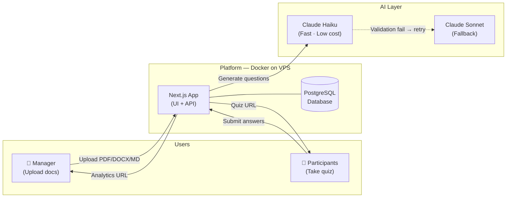
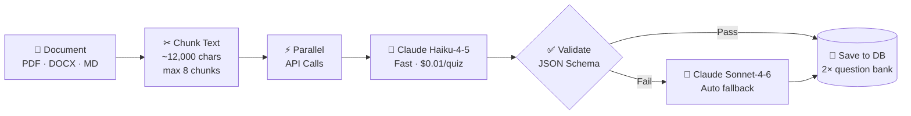
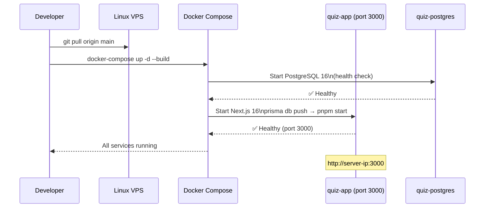

# AI-Driven Knowledge Assessment Platform
## Executive Technical Summary — Management Presentation

**Version:** 1.0 | **Date:** 2026-05-13 | **Audience:** Japanese Technical Managers

---

## SLIDE 1 — What We Built

**One-line definition:**
> Upload a company document → AI generates a quiz → Share a link → Track results.

**Business value at a glance:**

| Before | After |
|---|---|
| Hours of manual quiz writing | Under 30 seconds per document |
| No visibility into comprehension | Real-time analytics dashboard |
| Complex LMS setup required | Single public URL, zero login |
| Answer sharing between participants | Unique randomized quiz per person |

**AI cost per quiz: < $0.01**

---

## SLIDE 2 — System Architecture



**Three roles, two URLs:**
- **Quiz URL** `/q/{token}` — share with all participants
- **Results URL** `/results/{token}` — manager-only analytics

---

## SLIDE 3 — AI Pipeline



**Key AI design decisions:**

- **Dual-model strategy** — Fast primary model; high-capability fallback on failure only
- **2× question bank** — Generates double the requested questions; randomizes selection per session
- **Source-grounded prompts** — Model is forbidden from inventing facts not in the document
- **Temperature = 0.4** — Deterministic enough to avoid hallucination; varied enough for diverse questions
- **Zod schema validation** — Every AI response structurally checked before saving

---

## SLIDE 4 — Build & Run

**Prerequisites (Docker deployment):**
- Docker v20.10+ and Docker Compose v2.0+
- Linux VPS (Ubuntu 20.04+ recommended), 2 vCPU / 2 GB RAM
- Anthropic API Key

**Required configuration (`.env.local`):**
```
POSTGRES_PASSWORD=StrongPassword123
ANTHROPIC_API_KEY=sk-ant-...
NODE_ENV=production
```

**Complete startup — 3 commands:**
```bash
git clone <repo> && cd quiz-knowledge
cp .env.docker .env.local   # fill secrets
docker-compose up -d --build
```

**First build:** ~10 minutes | **Subsequent restarts:** ~30 seconds

---

## SLIDE 5 — Deployment Flow



**Infrastructure summary:**

| Component | Technology | Details |
|---|---|---|
| Application | Next.js 16 + Node 22 | Docker container |
| Database | PostgreSQL 16 | Docker container, persistent volume |
| File storage | Local disk | `.uploads/` volume (Supabase optional) |
| Schema migration | Prisma (`db push`) | Runs automatically at startup |
| Restart policy | `unless-stopped` | Auto-recovers after server reboot |

---

## SLIDE 6 — Key Features & Strengths

**Implemented features:**

- **Multi-file upload** — Up to 5 documents combined into one quiz
- **Format support** — PDF, DOCX, Markdown, TXT, CSV, HTML (max 15 MB each)
- **Anti-cheating randomization** — Unique question subset + shuffled options per participant
- **30-minute timed sessions** — Sessions expire; no replay after submission
- **Analytics dashboard** — Attempt count, average score, per-question accuracy rates
- **Identifier collision handling** — Automatic suffix for duplicate participant names

**Technical strengths:**

| Strength | Benefit |
|---|---|
| Self-hosted Docker stack | No vendor lock-in; runs on any Linux VPS |
| Single codebase (Next.js) | Frontend + Backend + API in one repo |
| Zod validation everywhere | API inputs and AI outputs are always type-safe |
| Atomic DB transactions | Quiz + questions + options saved together or not at all |
| Automatic AI fallback | System self-heals on model validation failure |
| < $0.01 per quiz | Scalable AI cost with primary fast model |

---

## SLIDE 7 — Roadmap (Next Steps)

| Priority | Enhancement |
|---|---|
| 🔴 High | CI/CD pipeline (GitHub Actions auto-deploy) |
| 🔴 High | HTTPS/SSL via Nginx + Let's Encrypt |
| 🔴 High | Manager authentication (login to protect upload/analytics) |
| 🟡 Medium | Async quiz generation (remove 30s wait for large documents) |
| 🟡 Medium | Difficulty balance control (easy/medium/hard ratio) |
| 🟢 Low | LMS integration (SCORM/xAPI export) |
| 🟢 Low | Scheduled cleanup of old quizzes |

---

*Detailed technical reference: `02_KNOWLEDGE_MNG_HACKATHON_Technical_Document_Detail_v1.0.md`*  
*Prepared for: AI Innovation Competition — Internal Review 2026*
